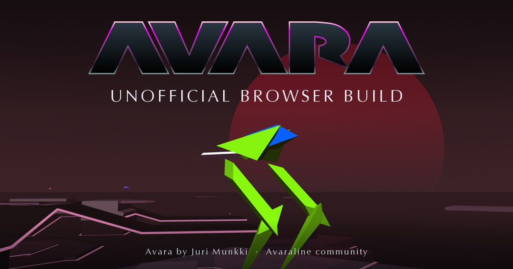
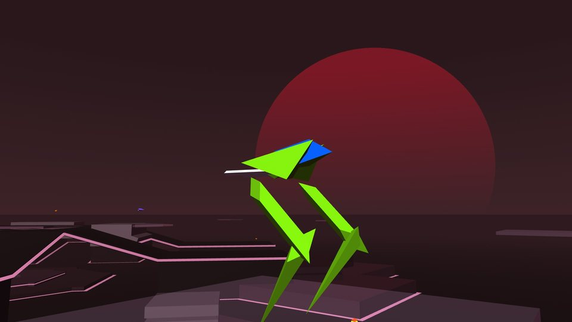
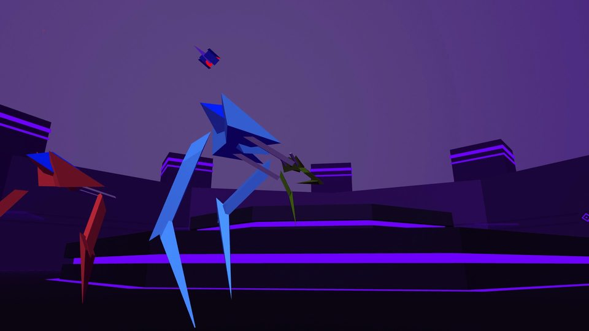
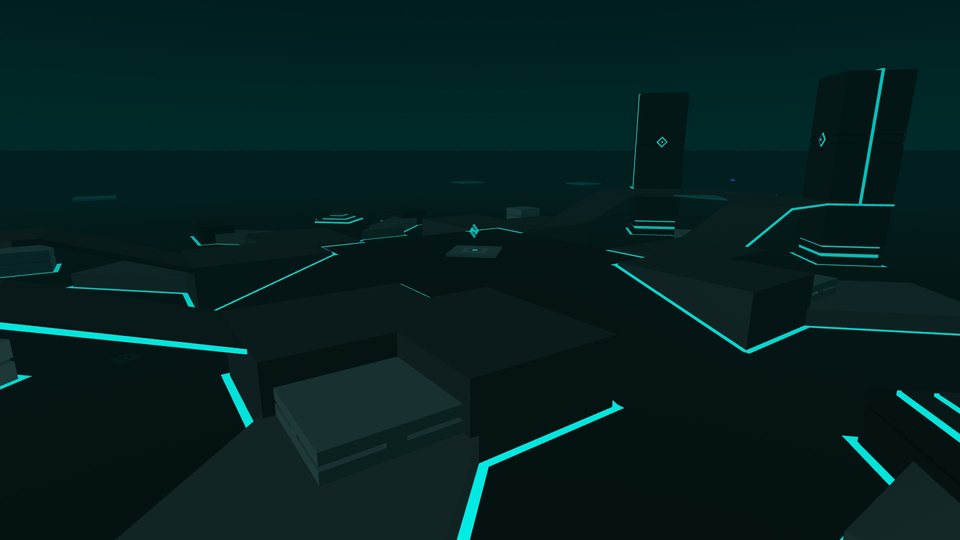
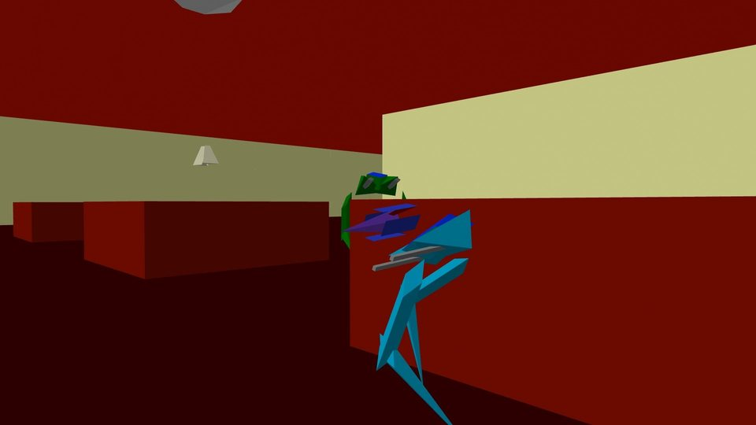
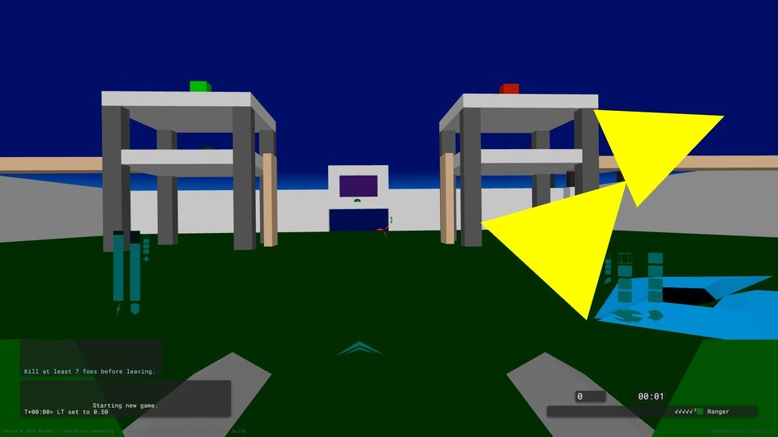
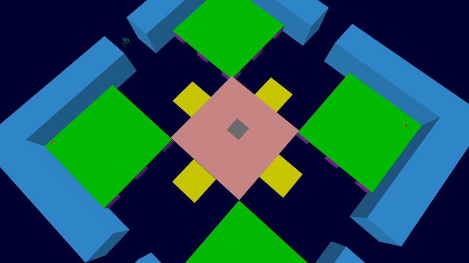

  

# Avara in a browser (unofficial)

This fork of [avaraline/Avara](https://github.com/avaraline/Avara) builds Avara for the web,
with Emscripten, WebGL2 and WebRTC.

**Play: <https://cfreder2.github.io/avaraline-web/>**

It is not made, run or endorsed by the Avaraline project. Avara is Juri Munkki's game, ported
to current systems and maintained by the Avaraline community: for the project, the desktop app
and its documentation, see [avaraline/Avara](https://github.com/avaraline/Avara). This fork was
made with AI assistance: [AI.md](AI.md) says how, and what is not AI-made. Problems with the
browser build go in [this repository's issues](https://github.com/cfreder2/avaraline-web/issues),
not Avaraline's.

<!-- Trailer: put the github.com/user-attachments/assets/... link that GitHub gives for
     Avara-trailer-10MB.mp4 on its own line here, with a blank line above and below. -->
     

https://github.com/user-attachments/assets/9c28ca84-859d-4c96-8774-ff18bf4693ae

<table>
  <tr>
    <td> Origins, by Sphinx</td>
    <td> Decagon, by Sphinx</td>
    <td> Messiah, by Sphinx</td>
  </tr>
  <tr>
    <td> Disco, by Apollo (2000)</td>
    <td> Fort of Bob, by Juri Munkki (1996)</td>
    <td> Platforms, by Carlos Castillo-Garsow (1996)</td>
  </tr>
</table>

## What the browser build does

- Solo, or host and join online games. The Online screen lists browser games, and the desktop
  games on Avaraline's tracker beside them.
- Avara's levels, downloaded when a game needs them.
- Optional accounts, with an Elo rating and a friends list. Without one you play as a guest.
- Keyboard and mouse, or a gamepad.
- Not yet: browser and desktop players in the same game.

## How it relates to Avaraline's code

The changes are kept in separate branches, so that any of them could be offered upstream:

- `port-fixes`: bugs the port found that affect desktop builds too.
- `web-build`: the Emscripten build, on top of `port-fixes`. Every change to an existing C++
  file is inside `#ifdef __EMSCRIPTEN__`.
- `netplay-pacing`: lockstep over WebRTC, on top of `web-build`.
- `actor-smoothing`: draws actors that update at 15 Hz between their updates.
- `small-fixes`: says why Start/Ready does nothing when no level is loaded.
- `site` (this branch): all of the above, plus the page at github.io. Not meant for upstream.

To check that `web-build` or `netplay-pacing` changes nothing a desktop build compiles, check
out the branch and run `python3 tools/check_web_gating.py port-fixes`. It removes the
`__EMSCRIPTEN__` blocks with `unifdef` and compares each file with `port-fixes`.

## Privacy

The page at github.io records play statistics in a Supabase database, to find bugs and to see
how well the build runs:

- for each visit: a random ID for the visit and one for the browser (Supabase's anonymous
  sign-in), the build, the callsign you play under, the kind of device, screen size, graphics
  renderer, time played, rounds, kills, deaths, wins and frame rate;
- for each round: the level, mode, number of players, outcome, score, frame rate, tick rate and
  network round trip;
- events: whether joining a game worked and how the connection got through, and level
  downloads.

It stores no IP addresses, e-mail addresses or chat. Visits are kept for 400 days, events for
90. **Settings > Send play statistics** turns it off.

A game you host is listed on the Online screen with its name, your callsign, the level and the
players. Accounts are optional: a username and a password, stored as a bcrypt hash, with no
e-mail address. In an online game players connect to each other directly, so each can see the
others' IP addresses; **Settings > Connect only through the host** limits that to the host.

## Building

    source ../emsdk/emsdk_env.sh          # Emscripten on PATH
    make -f Makefile.emscripten           # build_web/avara.{html,js,wasm,data}
    make -f Makefile.emscripten serve     # the plain page, at http://localhost:8000
    node tools/build.mjs                  # the site's page, staged in dist/

For desktop builds, see [avaraline/Avara](https://github.com/avaraline/Avara).

## Credits

Avara was created by Juri Munkki and published by Ambrosia Software in 1996. The Avaraline
community ported it to current systems: see [avaraline/Avara](https://github.com/avaraline/Avara)
and [its contributors](https://github.com/avaraline/Avara/graphs/contributors). The levels are
by their designers. [CREDITS.md](CREDITS.md) lists them all.
